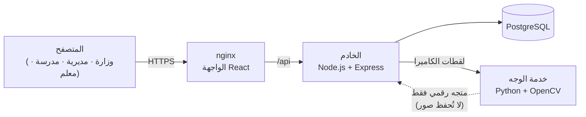

<div dir="rtl">

<p align="center">
  
</p>

<h1 align="center">النظام المركزي لدعم اتخاذ القرار في وزارة التربية والتعليم</h1>

<p align="center">
  منصة واحدة تربط <b>الوزارة</b> و<b>مديريات التربية</b> و<b>المدارس</b>: الحضور بالتعرّف على الوجه، النصاب التدريسي، الطلبات الإدارية، المراسلات والتعاميم، ومؤشرات تدعم القرار.
</p>

<p align="center">
  مشروع تخرّج · نموذج أولي (Pilot) لمديرية واحدة وخمس مدارس ببيانات مولّدة
</p>

---

## المحتويات
- [لمحة](#لمحة)
- [الوحدات والميزات](#الوحدات-والميزات)
- [المستخدمون والأدوار](#المستخدمون-والأدوار)
- [التقنيات والبنية](#التقنيات-والبنية)
- [التشغيل السريع عبر Docker](#التشغيل-السريع-عبر-docker)
- [التشغيل للتطوير (بدون Docker)](#التشغيل-للتطوير-بدون-docker)
- [حسابات التجربة](#حسابات-التجربة)
- [الاختبارات](#الاختبارات)
- [الأمان والخصوصية](#الأمان-والخصوصية)
- [هيكل المشروع](#هيكل-المشروع)

---

## لمحة

تعتمد الوزارة والمديريات اليوم على تقارير ورقية متأخرة لمعرفة ما يجري في المدارس. يجمع هذا النظام البيانات من مصدرها (حضور الكادر، تنفيذ الحصص، احتياجات المدارس) ويحوّلها إلى **مؤشرات وتنبيهات وأولويات مُعلَّلة** تساعد صاحب القرار.

**المبدأ الأساسي:** النظام **يدعم القرار ولا يتخذه** — لا يحكم بالغياب آلياً، ولا يقبل أو يرفض طلباً بنفسه؛ كل درجة أو تنبيه يأتي مع أسبابه بالأرقام.

---

## الوحدات والميزات

| الوحدة | أهم ما فيها |
|---|---|
| **الصلاحيات والتدقيق** | 7 أدوار، عزل كامل للنطاق (المدرسة ترى مدرستها، المديرية مدارسها، الوزارة أرقاماً مجمّعة)، سجل تدقيق لا يُعدّل ولا يُحذف، إنهاء الجلسة بعد 30 دقيقة خمول |
| **البيانات المدرسية** | المدارس (حلقة أولى/ثانية/ثالثة)، الكادر (معلم مثبّت أو وكيل)، الصفوف والشعب والفروع، الطلاب، تحذير من السجلات المكررة |
| **الجداول والنصاب** | جدول حصص لكل شعبة دون تعارض حتى بين المدارس، نصاب المثبّت حسب سنوات الخدمة (22/21/19) ونصاب الوكيل حسب ساعات تكليفه، الحصص المنفّذة والمتبقية، الإجازات والتكليفات الرسمية |
| **الحضور** | تسجيل **بالتعرّف على الوجه** مع تحقق من الحيوية، تصنيف يومي (حاضر، متأخر، خروج مبكر، تسجيل ناقص، غياب محتمل)، تصحيحات باعتماد المدير، حوادث انقطاع الكهرباء، ملف **Excel** شهري |
| **المحصّلات** | المعلم يُدخل محصّلة كل طالب لكل فصل ويرفعها للموجّه؛ بعد الرفع التصحيح للموجّه فقط بسبب إلزامي، يُسجَّل (القديمة/الجديدة) ويصل إشعار للمعلم |
| **الطلبات الإدارية** | صيانة، كتب، تجهيزات، نقص كادر، **إنشاء حساب معلم**؛ مسار كامل حتى تأكيد المدرسة للاستلام، تعليقات ومرفقات، و**درجة أولوية 0–100** مُعلَّلة |
| **المراسلات والتعاميم** | تعاميم الوزارة، إشعارات المديرية، وارد وصادر لكل مدرسة، ومتابعة **من فتح الرسالة ومن أكّد استلامها** |
| **اللوحات** | مؤشرات لكل دور: الأعداد، نسب الحضور، إنجاز النصاب، ما يحتاج انتباهك |

### الخوارزميات (قلب "دعم القرار")
كل خوارزمية مكتوبة كدالة مستقلة قابلة للاختبار في `backend/src/algorithms/`:

- **مصنّف الحضور اليومي** — يقارن حركات الدخول والخروج بجدول المعلم الفعلي مع سماحية قابلة للضبط، ويستثني فترات الانقطاع والإجازات، ويُرفق سبباً لكل حالة.
- **أولوية الطلبات** — مجموع موزون لخمسة عوامل (الخطورة، نسبة الطلاب المتأثرين، مدة الانتظار، هشاشة المدرسة، تكرار الطلب)، يُحسب عند العرض لأنه يتغيّر مع الوقت، وأوزانه قابلة للضبط من المديرية.
- **التعرّف على الوجه** — OpenCV YuNet للكشف و SFace لاستخراج متجه من 128 رقماً، مع تحدّي لفّ الرأس للتحقق من أن الوجه حيّ.

---

## المستخدمون والأدوار

| الدور | ماذا يفعل |
|---|---|
| مسؤول الوزارة | التعاميم، المؤشرات المجمّعة لكل المدارس، إعدادات النظام |
| مسؤول المديرية | مراجعة طلبات المدارس وترتيبها حسب الأولوية، مراسلة مدارسها، إنشاء حسابات المعلمين، الإعدادات |
| مدير المدرسة | الكادر والطلاب والجداول، تسجيل الوجوه، اعتماد تصحيحات الحضور، الطلبات والمراسلات، ملف Excel |
| نائب المدير | مثل المدير للقراءة، واقتراح التصحيحات، والطلبات بتفويض من المدير |
| الموجّه | مراجعة محصّلات الطلاب وتصحيحها |
| المعلم | إدخال محصّلات طلابه ورفعها للموجّه، وجدوله ونصابه وحضوره (للاطلاع) |
| موظف المدرسة | تشغيل جهاز الحضور بالوجه، والاطلاع على حضوره |

---

## التقنيات والبنية

| الطبقة | التقنية |
|---|---|
| الواجهة | React 19 · TypeScript · Vite · Bootstrap 5 (RTL) · خط Cairo |
| الخادم | Node.js 22 · Express 5 · TypeScript · JWT · bcrypt |
| قاعدة البيانات | PostgreSQL 18 — 37 جدولاً، قواعد العمل الحرجة مفروضة بـ 13 trigger |
| خدمة الوجه | Python 3.13 · FastAPI · OpenCV (YuNet + SFace) |
| التشغيل | Docker Compose · nginx |



---

## التشغيل السريع عبر Docker

المتطلبات: [Docker Desktop](https://www.docker.com/products/docker-desktop/) (يتضمن Docker Compose).

```bash
# 1) ملف الإعدادات السرية
cp .env.docker.example .env
#    ثم عدّل القيم داخل .env (كلمة سر القاعدة، JWT_SECRET، FACE_KEY)

# 2) بناء وتشغيل كل الخدمات
docker compose up -d --build

# 3) افتح المتصفح
#    http://localhost:8080
```

- في **أول تشغيل** تُنشأ قاعدة البيانات تلقائياً من `database/schema.sql` ثم `defaults.sql` ثم بيانات التجربة `seed.sql`.
- لإعادة القاعدة إلى حالتها الأولى: `docker compose down -v` ثم `docker compose up -d`.
- خدمة الوجه تنزّل نموذجَي OpenCV الرسميين أثناء البناء (يحتاج إنترنت مرة واحدة).
- **الكاميرا** تعمل في المتصفح على `localhost` أو عبر **HTTPS** فقط. عند النشر على خادم حقيقي ضع النظام خلف شهادة HTTPS.

---

## التشغيل للتطوير (بدون Docker)

المتطلبات: Node.js 22، PostgreSQL 18، Python 3.13.

```bash
# قاعدة البيانات
createdb -U postgres school_pilot
psql -U postgres -d school_pilot -f database/schema.sql
psql -U postgres -d school_pilot -f database/defaults.sql
psql -U postgres -d school_pilot -f database/seed.sql

# الخادم  (http://localhost:5000)
cd backend
cp .env.example .env        # ثم املأ القيم
npm install
npm run dev

# الواجهة  (http://localhost:5173)
cd frontend
npm install
npm run dev

# خدمة الوجه  (http://127.0.0.1:8001) — اختيارية؛ بدونها يعمل كل شيء عدا الحضور بالوجه
cd face-service
python -m venv .venv
.venv/Scripts/python -m pip install -r requirements.txt      # على Linux/macOS: .venv/bin/python
# نزّل النموذجين إلى face-service/models/ (انظر face-service/README.md)
.venv/Scripts/python -m uvicorn app:app --host 127.0.0.1 --port 8001
```

تغييرات قاعدة البيانات تُكتب كملفات في `database/migrations/` بالترتيب، وبيانات التجربة تُولَّد بـ `python database/generate_seed.py` (بتاريخ آخر يوم دوام قبل اليوم تلقائياً). لإعادة بناء القاعدة كاملة بنقرة وحدة على Windows: `powershell -File database\rebuild.ps1`.

---

## حسابات التجربة

كل الحسابات كلمة مرورها: **`Test@1234`** (بيانات مولّدة للتجربة فقط).

| الدور | اسم المستخدم |
|---|---|
| الوزارة | `ministry.admin` |
| المديرية | `directorate.admin` |
| مدراء المدارس | `principal1` … `principal5` |
| النوّاب | `deputy1` … `deputy5` |
| الموجّهون | `supervisor1` … `supervisor5` |
| موظفو المدارس | `staff1` … `staff5` |
| معلمو المدرسة 1 | `t1006` … `t1018` |

> بيانات الحضور التجريبية تغطي الأسابيع الأربعة السابقة لـ 2026-11-12.

---

## الاختبارات

```bash
cd backend
npm test
```

32 اختبار وحدة للخوارزميات: مصنّف الحضور (18)، أولوية الطلبات (10)، تشفير متجهات الوجه والتشابه (4).
إضافة إلى ذلك اختُبرت كل وحدة عبر الـ API (صلاحيات، نطاق، مسارات العمل) وقواعد قاعدة البيانات (triggers).

---

## الأمان والخصوصية

- **لا تُحفظ صور الوجوه أبداً** — تُعالَج في الذاكرة وتُتلف فوراً؛ يُحفظ متجه رقمي **مشفّر بـ AES-256-GCM** ومفتاحه خارج قاعدة البيانات.
- كلمات المرور مشفّرة بـ bcrypt، وكل الاستعلامات مُعلَّمة (Parameterized) ضد SQL Injection.
- **عزل النطاق** مُطبَّق في الخادم عند كل طلب، لا في الواجهة فقط.
- **الجلسات:** التوكن صالح 30 دقيقة ويتجدّد تلقائياً مع النشاط (انتهاء الخمول من جهة الخادم)، والحساب المعطّل يفقد الوصول فوراً، وتوكنات الوجه المؤقتة لا تُقبل كتوكن دخول.
- **قفل الدخول:** 5 محاولات خاطئة لنفس الاسم والعنوان = قفل 15 دقيقة (ويُسجَّل بسجل التدقيق).
- بالإنتاج (Docker) يرفض الخادم الإقلاع إذا كان `JWT_SECRET` أقصر من 32 حرفاً أو قيمة افتراضية.
- **سجلات غير قابلة للتعديل:** أحداث الحضور الخام، سجل التدقيق، الرسائل بعد إرسالها، والمحصّلات بعد رفعها (إلا بتصحيح موجّه مسجَّل) — كلها محمية بـ triggers داخل قاعدة البيانات.
- لا يعتمد المصحّح تصحيحه بنفسه، ولا يُغلق الطلب إلا بتأكيد المدرسة.
- الأسرار (`.env`) والملفات المرفوعة ونماذج الذكاء الاصطناعي **لا تُرفع إلى git**.

---

## هيكل المشروع

```
school-management-system/
├── backend/               خادم Node.js + Express (TypeScript)
│   └── src/
│       ├── algorithms/    الخوارزميات + اختباراتها
│       ├── routes/        واجهات الـ API لكل وحدة
│       ├── services/      منطق العمل واستعلامات SQL
│       └── middleware/    المصادقة والصلاحيات
├── frontend/              واجهة React (عربية RTL)
│   └── src/
│       ├── pages/         صفحات النظام
│       ├── components/    المكوّنات المشتركة
│       └── theme.css      الهوية البصرية
├── face-service/          خدمة التعرّف على الوجه (Python)
├── database/
│   ├── schema.sql         البنية الكاملة
│   ├── defaults.sql       الإعدادات المرجعية
│   ├── seed.sql           بيانات التجربة (مولّدة)
│   ├── generate_seed.py   مولّد بيانات التجربة
│   └── migrations/        تغييرات البنية بالترتيب
└── docker-compose.yml     تشغيل النظام كاملاً بأمر واحد
```

</div>
